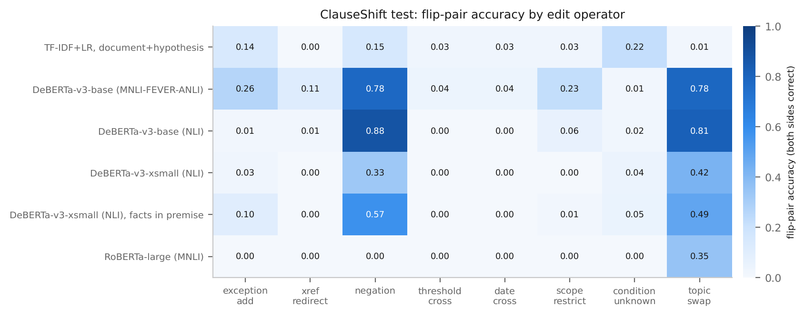
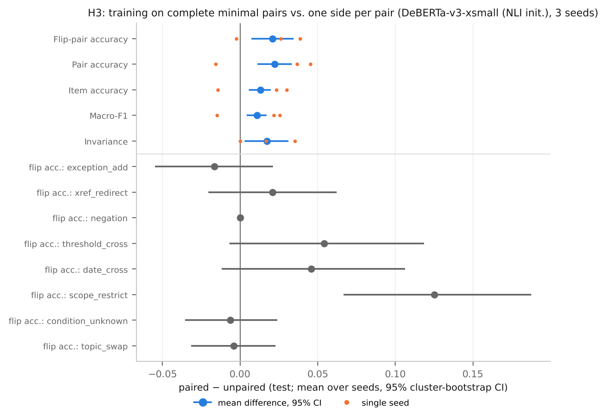
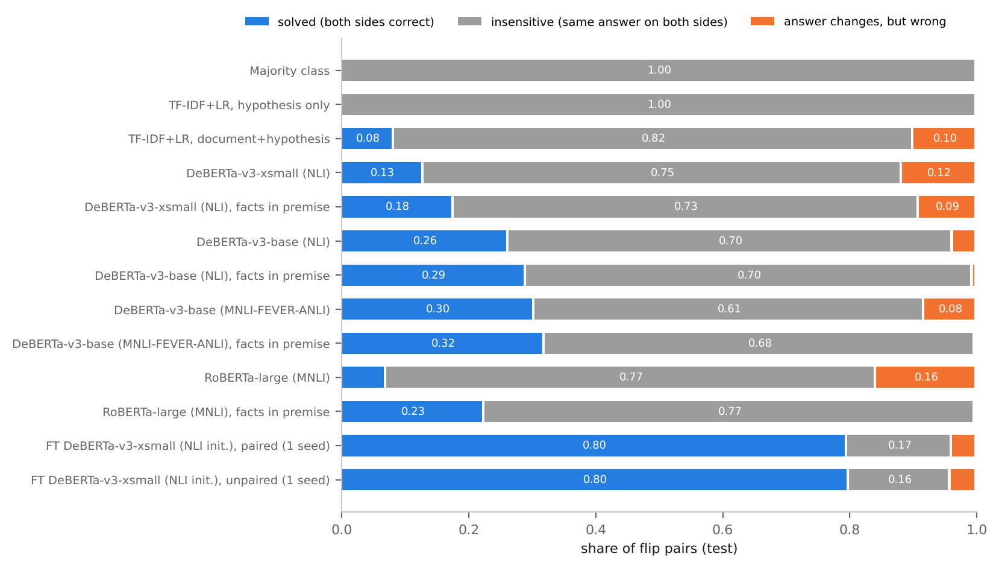
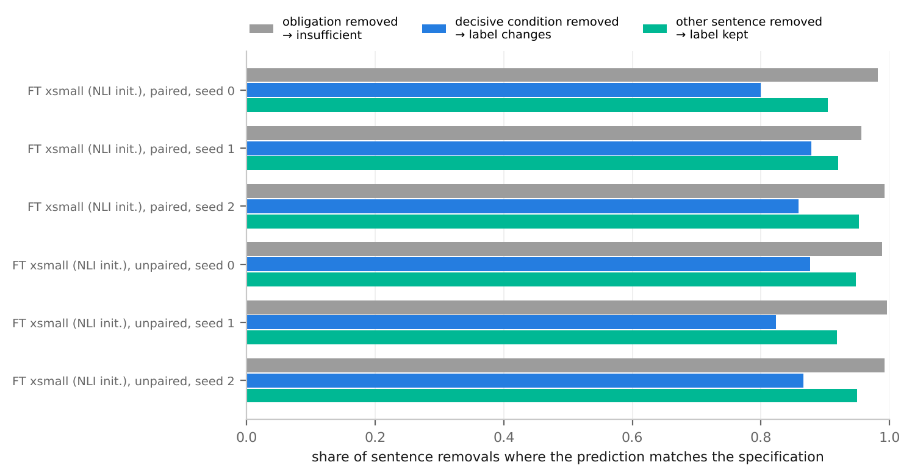

# ClauseShift

**Do NLI models notice the one clause that changes the answer?**

ClauseShift is a controlled diagnostic for three-way inference (`entailed` / `contradicted` / `insufficient`) over
short rule-like documents. Every test item belongs to a **minimal pair**: two documents that differ by one specified
edit (an exemption, a numeric threshold, a date cutoff, a cross-reference, a negation, …) and share the same
hypothesis about a case. Gold labels are computed from a rule specification, so the effect of each edit on the
correct answer is known exactly. A model is credited with a pair only if it answers both sides correctly.

> **Status (2026-11-25).** All preregistered experiments are complete: baselines, four zero-shot NLI models (plus an
> exploratory input-format control) and all 15 fine-tuning runs (paired vs. unpaired, operator hold-out, no NLI
> pre-training; three seeds each). Labels are generator-derived and have not yet been validated by human annotators.
> Technical report: [`docs/REPORT.md`](docs/REPORT.md).

## Research questions

Preregistered before any model was run ([`docs/PREREGISTRATION.md`](docs/PREREGISTRATION.md)):

| | Question | Hypothesis |
|---|---|---|
| RQ1 | How much does item accuracy overstate pair-level consistency? | H1: flip-pair accuracy ≥ 10 points below item accuracy |
| RQ2 | Which minimal edits are missed? | H2: exception and numeric/date boundary edits are harder than negation |
| RQ3 | At equal size, does training on complete pairs beat training on one side of each pair? | H3: paired > unpaired in flip-pair accuracy |
| RQ4 | Does performance survive a change of vocabulary and templates? | H4: accuracy drops from dev to test, more on reserved templates |
| RQ5 | Can labels be predicted without reading the document? | H5: a hypothesis-only model is near zero on flip pairs |

## Data and design

- **8,320 synthetic items / 4,160 minimal pairs** from 8 fictional rule families
  ([`docs/DATASET_CARD.md`](docs/DATASET_CARD.md)).
- **14 edit operators**: 8 change the label (exception added, cross-reference redirected, negation, threshold
  crossed, date crossed, scope restricted, condition on an unstated attribute, obligation replaced); 3 *near misses*
  change the text but not the label for this case; 3 are surface invariances (paraphrase, reordering, distractor).
- **Shift by construction**: train, dev and test use disjoint families (vocabularies), and the test set adds template
  phrasings never seen in training.
- **Shortcut control**: the preregistered hypothesis-only baseline exposed a claim-polarity shortcut in the first
  data version (0.60 dev accuracy). It was removed before any neural model was run
  ([`results/design_iterations/`](results/design_iterations/README.md)).
- **Integrity**: `scripts/verify_integrity.py` regenerates the data in memory, checks content hashes, validates every
  prediction file and recomputes every reported metric ([`results/INTEGRITY.md`](results/INTEGRITY.md)).

## Methodology

- **Systems**: majority class; TF-IDF + logistic regression (hypothesis only; document + hypothesis); four
  off-the-shelf NLI cross-encoders zero-shot (DeBERTa-v3 xsmall and base, DeBERTa-v3-base MNLI-FEVER-ANLI,
  RoBERTa-large-MNLI); DeBERTa-v3-xsmall fine-tuned under the preregistered conditions (paired vs. unpaired training
  at equal size, operator hold-out, no NLI pre-training).
- **Metrics**: accuracy, macro-F1, **pair accuracy**, **flip-pair accuracy** (both sides of a label-changing pair
  correct), flip sensitivity, invariance on near-miss/invariant pairs, occlusion evidence measures.
- **Statistics**: 95% percentile bootstrap over minimal pairs; paired bootstrap for every comparison (shared
  resampling matrix); cluster bootstrap over test pairs for multi-seed groups. Decision rules for H1–H5 are fixed in
  the preregistration; everything else is labelled exploratory.

## Findings (test set: 1,280 pairs, families never seen in training)

| System | Accuracy | Pair accuracy | Flip-pair accuracy |
|---|---|---|---|
| Majority class | 0.390 [0.371, 0.408] | 0.141 [0.121, 0.159] | 0.000 |
| TF-IDF + LR, hypothesis only | 0.415 [0.398, 0.432] | 0.124 [0.106, 0.142] | 0.000 |
| TF-IDF + LR, document + hypothesis | 0.413 [0.395, 0.432] | 0.170 [0.149, 0.191] | 0.083 [0.064, 0.102] |
| DeBERTa-v3-xsmall NLI, zero-shot | 0.399 [0.380, 0.419] | 0.181 [0.161, 0.204] | 0.129 [0.107, 0.153] |
| DeBERTa-v3-base NLI, zero-shot | 0.504 [0.484, 0.524] | 0.281 [0.257, 0.305] | 0.263 [0.233, 0.293] |
| DeBERTa-v3-base MNLI-FEVER-ANLI, zero-shot | 0.531 [0.511, 0.551] | 0.316 [0.291, 0.341] | 0.304 [0.272, 0.337] |
| RoBERTa-large-MNLI, zero-shot | 0.378 [0.358, 0.397] | 0.150 [0.130, 0.170] | 0.070 [0.053, 0.088] |
| RoBERTa-large-MNLI, zero-shot, facts in premise | 0.506 [0.487, 0.525] | 0.263 [0.240, 0.288] | 0.225 [0.198, 0.255] |
| DeBERTa-v3-xsmall fine-tuned, unpaired (3 seeds) | 0.891 ± 0.005 | 0.814 ± 0.008 | 0.795 ± 0.007 |
| DeBERTa-v3-xsmall fine-tuned, paired (3 seeds) | 0.904 ± 0.019 | 0.836 ± 0.025 | 0.815 ± 0.021 |

95% bootstrap intervals over pairs; fine-tuned rows: mean ± SD over seeds. Full tables: [`results/RESULTS.md`](results/RESULTS.md) (registered analyses) and
[`results/EXTENDED_ANALYSIS.md`](results/EXTENDED_ANALYSIS.md) (decision rules, paired comparisons, exploratory
analyses).

1. **Item accuracy hides edit insensitivity (H1 supported for all four zero-shot models).** On flip pairs, item
   accuracy exceeds flip-pair accuracy by 0.32–0.36. The dominant failure is *insensitivity*: 61–77% of flip pairs
   receive the same answer on both sides.
2. **The edits that decide real rules are the ones missed (H2 supported for the three DeBERTa models).** Negation
   and a replaced obligation are often handled (flip-pair accuracy up to 0.88 and 0.81), but numeric thresholds and
   date cutoffs reach at most 0.04, cross-references at most 0.11. RoBERTa-large-MNLI scores 0 on negation in the
   standard format, so H2 cannot hold for it.
3. **Input format explains one anomaly, not the main result (exploratory).** In the standard format the case facts
   sit in the hypothesis; RoBERTa-large-MNLI then never predicts `entailed`. Moving the facts into the premise raises
   its flip-pair accuracy by +0.155 [+0.122, +0.190] and its negation flip-pair accuracy from 0.00 to 1.00, and
   changes the other three models by +0.016 (interval includes 0) to +0.047. In both formats, threshold and date
   edits stay at ≤ 0.04 and cross-references at ≤ 0.11.
4. **H5 holds by construction** (a hypothesis-only model cannot solve a pair whose two sides share the hypothesis);
   the informative number is its item accuracy, 0.415 vs. 0.390 for the majority class.
5. **Fine-tuning closes most of the gap, except at boundaries.** DeBERTa-v3-xsmall fine-tuned on 2,400 items from
   other families reaches flip-pair accuracy 0.80–0.82 (zero-shot: 0.13). Thresholds (0.46–0.51), dates
   (0.62–0.67) and scope restrictions (0.54–0.67) remain the hardest edits.
6. **Training on complete pairs gives a small, fragile gain (H3 supported by the preregistered rule).** At equal
   size, paired training improves flip-pair accuracy by +0.021 [+0.006, +0.036] (three seeds; per-seed differences
   −0.002, +0.039, +0.026). The bootstrap treats seeds as fixed; a seed-level t-interval, [−0.032, +0.073],
   includes 0. Without NLI pre-training the sign reverses (−0.093 [−0.113, −0.074]), driven by one run that did not
   converge within the registered three epochs. Read with the mixed CAD literature, this is evidence of a small,
   initialisation-dependent effect, not a robust one.
7. **H4 is not supported.** Reserved test templates cost about 4 points of accuracy, but test accuracy is *higher*
   than dev accuracy: the single dev family is harder than the two test families, so family difficulty and shift
   cannot be separated with this split.
8. **Cross-references are a separate skill.** Trained without cross-reference and date pairs, models still handle
   unseen date edits (0.81) but not unseen cross-reference edits (0.04 [0.02, 0.07]; 0.84–0.86 when seen in
   training), although they handle the same exemption stated inline (0.97).
9. **The preregistered evidence metric is uninformative here.** Occlusion hit@1 is 0.97–1.00 for every neural
   model, from flip-pair accuracy 0.07 to 0.82, because the obligation sentence is in every evidence set. A
   counterfactual removal test with specification-derived labels separates the models: removing the decisive
   condition gives the expected label in 80–88% of cases after fine-tuning, 0–72% zero-shot.

<p align="center">
  
</p>
<p align="center">
  
</p>
<p align="center">
  
</p>
<p align="center">
  
</p>

## Methodological notes

- **Preregistration and deviations.** Hypotheses, splits, models, metrics and decision rules were fixed before any
  model was run. Everything added later (format control, seed-aware statistics, evidence tests) is labelled
  exploratory, and every deviation is listed in [`docs/PREREGISTRATION.md`](docs/PREREGISTRATION.md). No run was
  repeated, excluded or replaced.
- **Statistics.** Intervals are percentile bootstraps over minimal pairs with a shared resampling matrix, so every
  comparison is paired. Seed groups additionally get a cluster bootstrap and a seed-level t-interval, because the
  registered bootstrap treats training runs as fixed.
- **Evidence.** The counterfactual removal test relies on [`src/clauseshift/evidence.py`](src/clauseshift/evidence.py),
  validated against the generator on 706 pairs ([`tests/test_evidence.py`](tests/test_evidence.py)). Removal
  variants drop the article headers; a header-free control quantifies that effect.
- **Confounds.** Per-operator accuracy mixes edit type with document complexity: negation documents carry no
  conditions, threshold and date documents about two (`results/EXTENDED_ANALYSIS.md` §6).
- **Reproduction.** Re-running a stored zero-shot system on different hardware reproduced its predictions exactly
  ([`results/reproduction_check.json`](results/reproduction_check.json)).

## Limitations

Synthetic, template-generated English with ~100-token documents; labels derived from a specification and not yet
human-validated (a blind sample of 112 items is prepared in `review/`; a single-LLM audit of that sample agreed
with the generator on 112/112 items, [`review/clauseshift_llm_audit.md`](review/clauseshift_llm_audit.md), which is a
consistency check, not human validation); compact encoders and a CPU budget, no
instruction-tuned LLMs; two test families; a three-epoch training budget (12 of 15 runs selected the last epoch). ClauseShift measures sensitivity to decisive edits in controlled rule
language. It is not a measure of legal competence, and results should not be extrapolated to real documents without
validation on real text.

## Positioning

Closest prior work: contrast sets (Gardner et al., 2020), counterfactually augmented data (Kaushik et al., 2020;
Huang et al., 2020; Joshi & He, 2022) and CLAUSE (Choudhury et al., Findings of EACL 2026), which perturbs real
contracts. ClauseShift adds exact single-edit control with spec-derived labels, an `insufficient` class reached by
edits, near-miss controls, and a size-matched test of training on pairs. It is a controlled diagnostic, not a new
paradigm ([`docs/LITERATURE_REVIEW.md`](docs/LITERATURE_REVIEW.md)).

## Reproduce

```bash
pip install --index-url https://download.pytorch.org/whl/cpu torch==2.5.1
```
```bash
pip install -r requirements.txt
```
```bash
python -m pytest -q && python scripts/verify_integrity.py
```
```bash
python scripts/run_baselines.py && python scripts/run_zero_shot.py
```
```bash
bash scripts/run_cloud_queue.sh   # facts-in-premise, fine-tuning, evidence; restartable, ~6.5 h on 4 CPU cores
```
```bash
python scripts/analyze.py && python scripts/analyze_extended.py && python scripts/error_analysis.py
```

## Repository map

| Path | Content |
|---|---|
| `src/clauseshift/` | generator, domains, integrity checks, metrics, NLI inference, evidence expectations |
| `data/` | frozen dataset v2 and manifest of content hashes |
| `scripts/` | experiments, analyses, integrity and reproduction checks |
| `results/` | predictions, generated tables, figures |
| `docs/` | preregistration, dataset card, model card, literature review, [technical report](docs/REPORT.md), [study guide](docs/STUDY_GUIDE.md) |
| `review/` | blind annotation sample (not yet annotated) |

## AI-assisted development

The code, data generator, analyses and documentation were produced with substantial assistance from an AI coding
assistant, working from the author's instructions. Every reported number is generated by the scripts in `scripts/`
from saved predictions; none was entered by hand. No human annotation or independent validation of the labels has
taken place yet.

MIT license.
